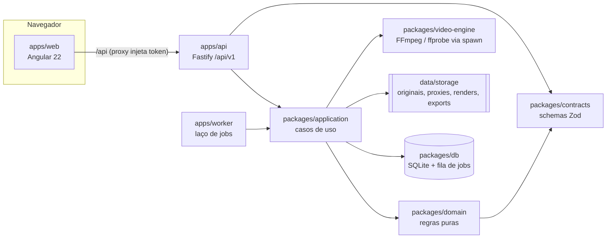
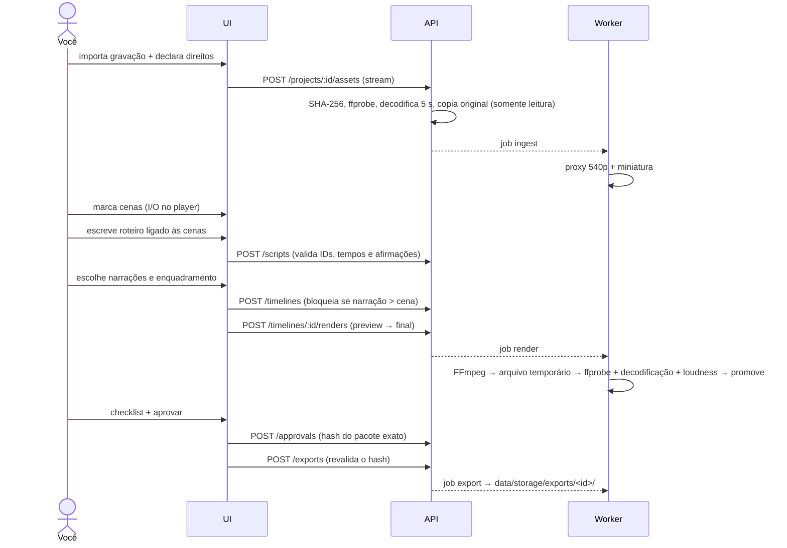

# Arquitetura — Racing Studio AI (M0 + M1)

## Visão geral

| Pasta | Responsabilidade (spec §7) |
|---|---|
| `packages/contracts` | Schemas Zod e tipos (Project, Asset, Event, ScriptVersion, TimelineVersion, Render, Approval, Job…) |
| `packages/domain` | Regras sem I/O: validação de fontes do roteiro, narração que não cabe, recorte sem esticar, legendas ≤2 linhas, SRT/VTT, hash do pacote, aprovação, backoff |
| `packages/db` | Configuração, SQLite (`node:sqlite`) com migrações, armazenamento local protegido contra *path traversal*, fila de jobs com lease/heartbeat |
| `packages/video-engine` | Inspeção (ffprobe), proxy, miniatura, render da timeline, loudness, validação do MP4 |
| `packages/application` | Casos de uso (usados pela API, pelo worker e, no futuro, pelo MCP) e handlers dos jobs |
| `apps/api` | HTTP: autenticação por token, validação, erros padronizados `{code,message,requestId,details}`, download com Range |
| `apps/worker` | Executa jobs `ingest`, `analyze`, `render`, `export` |
| `apps/web` | Interface pt-BR acessível (Painel, Projeto em 5 etapas, Configurações) |
| `agents/` | Contratos dos papéis de IA (spec §13) |
| `templates/` | Perfis de vídeo e identidade (pendente) |

## Fluxo M1 (J1 manual)

## Estados

Projeto: `draft → media_ready → (analyzing) → events_review → script_review → producing → render_review → approved → exported`. Uma revisão (J3) pode voltar a `producing`/`script_review`.

Job: `queued → running → succeeded | failed | cancelled`. Erro transitório volta para a fila com backoff exponencial + jitter (máx. 3 tentativas). Um worker que cai perde o *lease* (30 s) e o job é retomado por outro; se o MP4 final já tinha sido promovido, ele só é revalidado — não é renderizado de novo.

## Invalidação (J3, AC-008)

| Mudança | Invalida |
|---|---|
| Nova versão do roteiro | todas as timelines (marcadas `stale`), renders delas e aprovações ativas |
| Nova versão da timeline (crop, legendas, mixagem) | timelines anteriores e aprovações ativas |
| Título/descrição/thumbnail diferentes | o hash do pacote muda → precisa de nova aprovação |

A aprovação guarda `packageHash = sha256(render, legendas, metadados, thumbnail, canal, versão/hash do roteiro e da timeline)`. Exportar e publicar recalculam esse hash e bloqueiam se divergir.

## Segurança (spec §16)

- API só em `127.0.0.1`; todo endpoint (exceto `/health`) exige `Authorization: Bearer <STUDIO_TOKEN>`. O proxy do Angular injeta o token a partir do `.env`, então ele não vai para o código do navegador.
- FFmpeg/ffprobe sempre por `spawn` com argumentos separados, sem shell.
- Cliente nunca envia caminho de arquivo: tudo é referenciado por ID; `storageKey` é validado e canonicalizado.
- Extensão é conferida contra o conteúdo real (ffprobe); arquivo corrompido é rejeitado.
- Exportação não inclui configuração nem segredos (verificado no teste E2E).

## Decisões registradas

- [ADR-001 — SQLite no lugar de PostgreSQL no MVP](adr/ADR-001-sqlite.md)
- [ADR-002 — Legendas como faixa embutida + SRT](adr/ADR-002-legendas.md)
- [ADR-003 — Monorepo npm workspaces executado com tsx](adr/ADR-003-monorepo.md)
